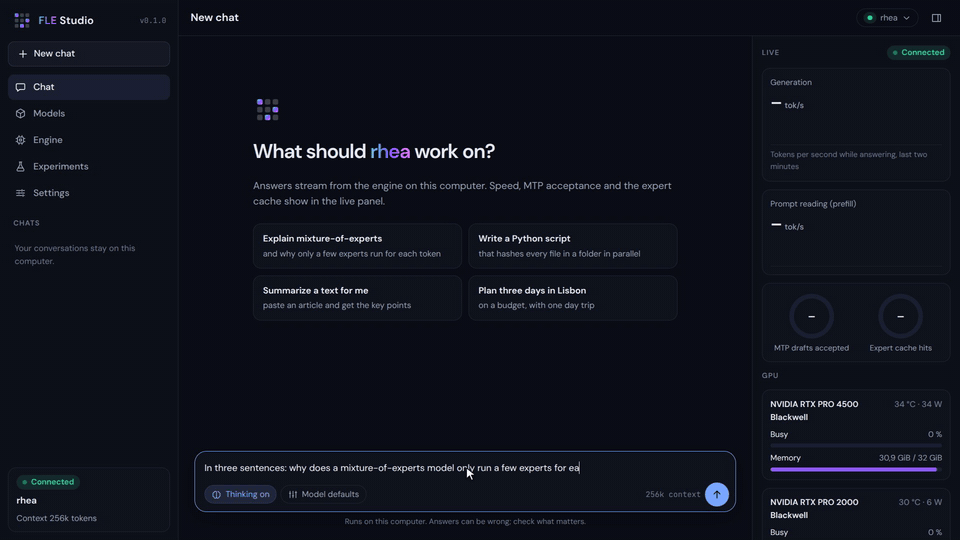
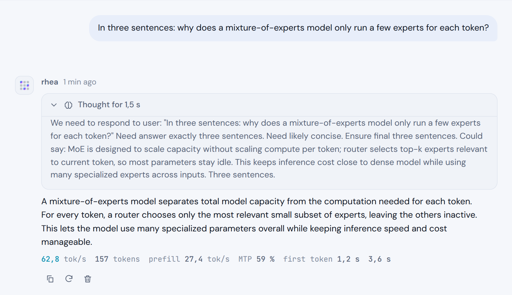
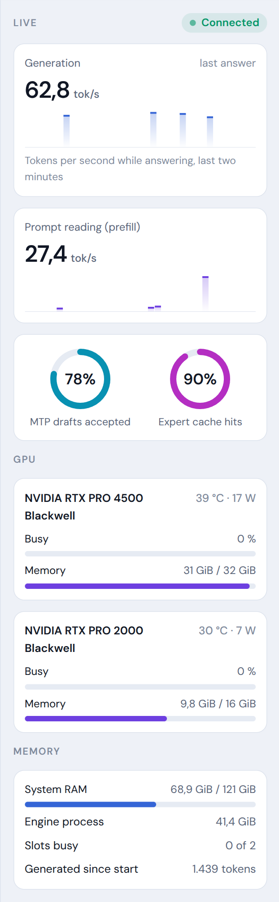
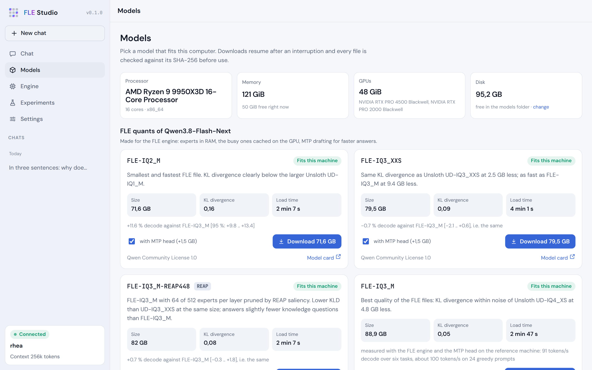
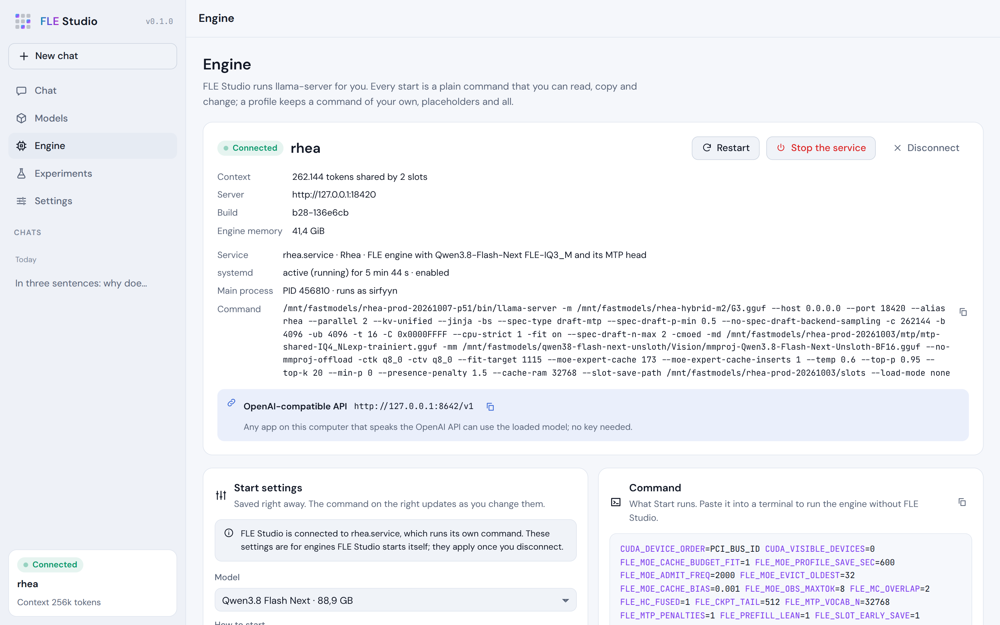
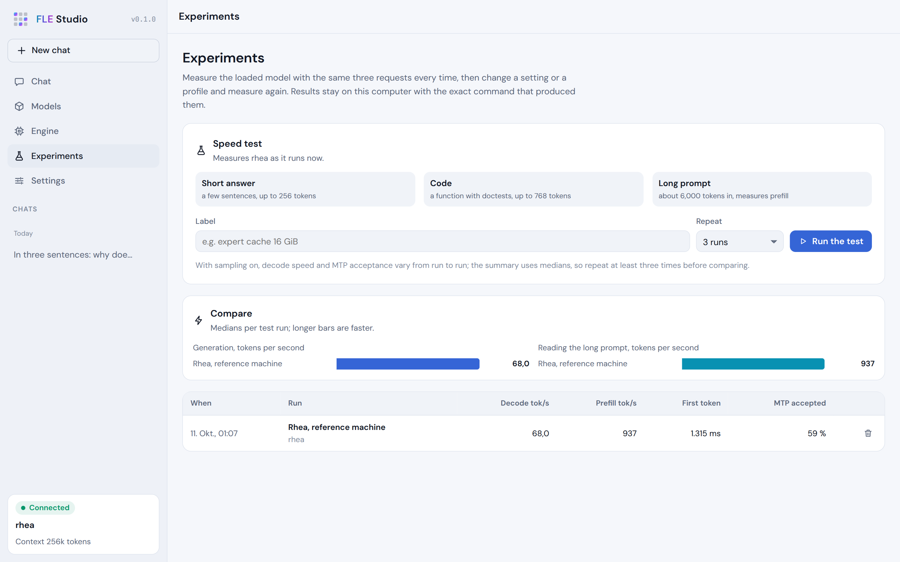

# FLE Studio

Run large Mixture-of-Experts models on your own computer. FLE Studio is one local app: a chat in your browser,
live numbers while the model answers, a model loader and launch profiles. It works with the
[FLE engine](https://github.com/sirfyyn/FastLocalExperts) and with plain
[llama.cpp](https://github.com/ggml-org/llama.cpp) on macOS, Linux and Windows.

<a href="docs/media/fle-studio.mp4"></a>

- No account, no telemetry, nothing runs in the cloud. Chats, settings and models stay on your machine.
- Python standard library only, no runtime dependencies. The installer brings its own Python.
- MIT licensed.

Status: 0.2, still early (0.x). It is new, so expect rough edges, and please open an issue when you find one.

## Install

macOS and Linux:

```sh
curl -LsSf https://raw.githubusercontent.com/sirfyyn/fle-studio/main/install.sh | sh
```

Windows (PowerShell):

```powershell
irm https://raw.githubusercontent.com/sirfyyn/fle-studio/main/install.ps1 | iex
```

To try it without installing it as a tool (needs [uv](https://docs.astral.sh/uv/) and git):

```sh
uvx --from git+https://github.com/sirfyyn/fle-studio fle-studio
```

What the installers do:

1. Install [uv](https://docs.astral.sh/uv/) if it is missing.
2. Install FLE Studio as a uv tool. uv brings its own Python 3.12, so your system Python is not touched.
3. On Windows, add a Start Menu shortcut named "FLE Studio".
4. Start FLE Studio, which opens in your browser.

They never ask for administrator rights or `sudo` and write only below your home directory. They need `git`,
because uv fetches FLE Studio from GitHub with it (macOS: `xcode-select --install`, Windows:
`winget install --id Git.Git -e`).

Options for the installers:

| What | macOS and Linux | Windows |
| --- | --- | --- |
| Install without starting | `curl -LsSf <url> \| sh -s -- --no-start` | `$env:FLE_STUDIO_NO_START = '1'` before `irm ... \| iex`, or run the script with `-NoStart` |
| Install another release, branch or commit | `curl -LsSf <url> \| FLE_STUDIO_REF=main sh` | `$env:FLE_STUDIO_REF = 'main'` before `irm ... \| iex`, or run the script with `-Ref main` |

On Windows, `& ([scriptblock]::Create((irm <url>))) -NoStart` runs the script with parameters without saving it.

Both installers can also install from a folder or a wheel file on your disk instead of GitHub (no git needed, and
nothing is fetched from PyPI): `FLE_STUDIO_SOURCE=/path/to/fle-studio sh install.sh`, or
`.\install.ps1 -Source C:\path\to\fle-studio` on Windows. A wheel comes from `python -m build`.

### Start, update, uninstall

```sh
fle-studio                          # start; opens http://127.0.0.1:8642 in your browser
uv tool upgrade fle-studio          # update (stays on the release you installed, see below)
uv tool uninstall fle-studio        # remove the program (your data stays)
```

The installer pins the release it installs (v0.2.2 at the time of writing), and `uv tool upgrade` follows that pin. To
move to a newer release, run the installer again; it always installs the release named in its own script, or the one
you set with `FLE_STUDIO_REF`.

Options of `fle-studio`:

| Option | Meaning |
| --- | --- |
| `--port N` | Port of the web page (default 8642). |
| `--host ADDRESS` | Address to listen on (default 127.0.0.1). `0.0.0.0` opens FLE Studio to your network; it then asks for an access key, which it creates and prints. |
| `--no-browser` | Do not open the browser. |
| `--attach URL` | Use a `llama-server` that is already running instead of starting one. |
| `--service UNIT` | Linux: connect to a `llama-server` that systemd runs as a service, for example `rhea.service` (see below). |
| `--home FOLDER` | Keep all data in this folder (portable installs, tests). |

Your data (settings, chats, engines, models) lives in `~/Library/Application Support/FLE Studio` on macOS,
`~/.local/share/fle-studio` on Linux and `%LOCALAPPDATA%\FLE Studio` on Windows. Uninstalling does not delete it.

### Updates

FLE Studio looks for a newer release about once a day (and when you press **Check now** in Settings → Updates). It asks
`api.github.com` for the latest release of `sirfyyn/fle-studio` and sends nothing about you or your machine. The answer
is cached; offline, it stays silent. Switch the check off, or include pre-releases, in Settings → Updates.

When a newer version exists, a quiet card appears in the sidebar: "FLE Studio X.Y.Z is available". It opens the release
notes (shown as plain text), a link to the release and **Later**, which hides that version.

- **One click** works when FLE Studio is installed as a uv tool (the installers do that) and does not run as a service.
  It runs `uv tool install --python 3.12 --force git+https://github.com/sirfyyn/fle-studio@vX.Y.Z`, then starts again
  with the same command line. If the install fails, the old version keeps running and you see the message and the log
  (`update.log` in the data folder). On Windows a small helper does the install after FLE Studio has ended, because the
  running program file is locked.
- **Everything else** (service mode, pip or virtual-environment installs, a folder or a wheel) shows the command to copy.
- **FLE engines** you installed from the Engine page: if a newer FLE engine build exists, the same card says so, and the
  Engine page has the **Update** button.

### From source

```sh
git clone https://github.com/sirfyyn/fle-studio
cd fle-studio
python -m pip install -e .
fle-studio
```

## What you get

**Chat.** An Open WebUI-style chat in the browser: Markdown and code blocks, a collapsible block for the model's
reasoning, streaming answers, the speed of each answer, and a history that stays on your computer. It also does
the everyday things (details in [docs/CHAT.md](docs/CHAT.md)):

- **Attachments.** Text and code files, PDFs (install the small `pypdf` library with `pip install "fle-studio[pdf]"`)
  and pictures, the last only when the loaded model can look at them. A token estimate warns before the context
  window is full. The largest upload is a setting.
- **Tools and MCP.** The model can call a calculator, the clock, read files in one folder you pick, and search the web
  (off by default), and the tools of any MCP server you add in the usual `mcpServers` JSON (stdio or Streamable HTTP).
  Every call is a card you can open. Anything that writes or starts a program asks first. Web servers can ask you to
  sign in (OAuth with PKCE; the token stays in Studio's data folder, mode 0600), older HTTP+SSE servers work as a
  fallback, and MCP Apps (`ui://` pages) show their result in a sandboxed frame in the chat. See
  [docs/MCP.md](docs/MCP.md): MCP: local, remote, sign-in, apps.
- **Edit, branch, search, export.** Edit a message of yours and the old version stays, with a `< 2 / 3 >` switch.
  Search all chats, export one as JSON or Markdown, import it again.

<picture>
  <source media="(prefers-color-scheme: dark)" srcset="docs/media/chat-reasoning-dark.png">
  
</picture>

**Live inference data.** While a model works: generation and prompt speed, the share of drafted tokens that were
accepted (when the engine uses a draft or MTP head), NVIDIA GPU use, and the expert-cache hit rate of the FLE engine.

<picture>
  <source media="(prefers-color-scheme: dark)" srcset="docs/media/live-data-dark.png">
  
</picture>

**Model loader.** The Models page lists the FLE quants of Qwen3.8-Flash-Next on Hugging Face
([FLE-GGUF](https://huggingface.co/sirfyyn/Qwen3.8-Flash-Next-FLE-GGUF),
[FLE-REAP448-GGUF](https://huggingface.co/sirfyyn/Qwen3.8-Flash-Next-FLE-REAP448-GGUF)) and tells you whether each
one fits your machine before you download anything. It also loads any GGUF repo from Hugging Face (search, or paste
`owner/name` or a link) and adds files you already have. Downloads can be paused and resumed, and each file is
checked against the SHA-256 that the Hub lists for it.

<picture>
  <source media="(prefers-color-scheme: dark)" srcset="docs/media/models-dark.png">
  
</picture>

**Launch profiles.** FLE Studio picks a sensible start command for your machine and shows it in full. You can save
your own profiles as a complete command with its environment, change the context size, GPU, threads and cache
budget, and see the exact command line before anything starts.

<picture>
  <source media="(prefers-color-scheme: dark)" srcset="docs/media/engine-dark.png">
  
</picture>

**Experiments.** A short, repeatable speed test (a short answer, a piece of code, a long prompt) that records prefill
and decode speed with the profile and engine used, so you can compare settings side by side.

<picture>
  <source media="(prefers-color-scheme: dark)" srcset="docs/media/experiments-dark.png">
  
</picture>

**Forge.** Build your own quant with the FLE recipe: take whole expert layers from the quants you already have,
quantize a full-precision model with `llama-quantize` and an importance matrix, optionally prune experts with REAP,
and check the result against the original (KL divergence, top-1 agreement, perplexity ratio). Jobs show progress and
can be cancelled and resumed; recipes are small JSON files that can be shared; a finished quant is published to the
library with a start profile. A small calibration text (public domain, CC0 or MIT, listed in
`src/fle_studio/forge/corpus/SOURCES.md`) ships with Studio. See [docs/FORGE.md](docs/FORGE.md).

<!-- Screenshots of Forge, the expert cache and the chat with an MCP app come with the release, made on the real
     hardware (the test screenshots show temporary folders of the test run). -->

**Tools and MCP.** The model can call a calculator, the clock, read files in one folder and search the web, and the
tools of MCP servers: programs (stdio), web servers (Streamable HTTP, with a **Sign in** button when a server wants
OAuth, and the older HTTP+SSE as a fallback) and MCP Apps, whose `ui://` pages show a tool's result in a sandboxed frame
in the chat. Anything that writes or starts a program asks first. See [docs/MCP.md](docs/MCP.md) and
[docs/CHAT.md](docs/CHAT.md).

**Updates.** About once a day (and with **Check now**) Studio asks GitHub for the latest release and shows a quiet
card in the sidebar; installs made with uv tool update with one click, others get the command to copy. It can be
switched off in Settings → Updates.

**Simple settings.** Theme, sampling (the model's recommended values or your own), the folder for models, the
Hugging Face token for gated repos, and network access.

**Tuning and quality.** On the Engine page the simple view has one button that tunes threads, the GPU expert
cache or `--n-cpu-moe`, and batch size by measuring, and saves the winner as a profile. Experiments show the median with
a 95 % interval over repeated runs, say "within noise" when a difference is not real, compare two settings A/B/A, and put
quality (KL divergence, a knowledge probe) next to speed. See [docs/TUNING-AND-QUALITY.md](docs/TUNING-AND-QUALITY.md);
the Expert cache page is described in [docs/EXPERT-CACHE-DATA.md](docs/EXPERT-CACHE-DATA.md).

**Live.** The first entry of the chat list. Everything that goes through the `/v1` address of FLE Studio, from the chat page and from any other program, shows up there as a temporary chat, so you can watch what a client really sends and what the model answers. Requests that repeat the earlier messages are joined into one conversation. Live is kept in memory only (the newest 100 messages, gone when Studio closes), pictures are left out, and nothing is written to disk. To keep something, press the star on a conversation, or on one message to keep everything up to it: that copies it into your normal chats as a favorite.

**Capture.** Off by default. In Settings → Capture you can keep what you do with the model: every chat answer that goes through FLE Studio (the chat page and any other client on the `/v1` address) is written as one line of JSON to a file in `<data folder>/capture/`, with the request, the answer, the speed and the draft tokens the engine accepted. Streamed answers are put back together, pictures are left out, the files are readable by you only, and a size limit stops the recording. Use it to build your own test set, calibration text or training data for a better draft head from your own work. Nothing is sent anywhere; "Delete all recordings" removes the files.

**Expert cache.** A page that reads the engine's log and shows how well the GPU expert cache works: hit rate over
time, the budget, and (when the engine prints it) the hot experts per layer.

## Engines

FLE Studio installs the engine that suits your machine. You can always choose another one, use your own
`llama-server`, or attach to a server that is already running.

| Your machine | Engine |
| --- | --- |
| Linux or Windows (x64) with an NVIDIA GPU and a CPU with AVX2 | FLE engine, CUDA build |
| Other NVIDIA setups on x64 | llama.cpp, CUDA build |
| macOS on Apple Silicon | llama.cpp, Metal build |
| Intel Mac | llama.cpp, CPU build |
| AMD or Intel GPU on Linux or Windows | llama.cpp, Vulkan build |
| Anything else | llama.cpp, CPU build (it works, but is slow for large models) |
| Your own build | Engine page: set the path to your `llama-server` |
| A server that is already running | Engine page, or `fle-studio --attach http://127.0.0.1:8080` |
| A server that systemd runs as a service (Linux) | Engine page (Service field), or `fle-studio --service rhea.service` |

The FLE engine is a llama.cpp fork that keeps a model's experts in RAM and caches the busy ones in GPU memory, so
that a model larger than your GPU memory can still run on a single GPU. It also supports a separate MTP head for
drafting. FLE builds come from the
[FastLocalExperts releases](https://github.com/sirfyyn/FastLocalExperts/releases), llama.cpp builds from the
[llama.cpp releases](https://github.com/ggml-org/llama.cpp/releases) (FLE Studio is tested with tag b11540). Each
download is checked against the SHA-256 digest that GitHub publishes for the file.

### A server that runs as a systemd service

On a machine where `llama-server` runs as a systemd unit, FLE Studio can work with the service instead of starting a
second server next to it. It reads the unit's own command (model, port, alias), follows the unit's journal, shows how
far the server has read the model while it loads, and offers Start, Stop and Restart for the unit. It never changes
the unit: systemd starts the server with the unit's command, as before. Disconnect leaves the service as it is. The
command shown on the Engine page hides `--api-key` and the Hugging Face token.

Two options in the unit fill the live panel. `--metrics` gives the speeds second by second; without it, the panel
shows the speeds of each finished answer. `-lv 4` lets the FLE engine's expert-cache hit rate into the journal, where
FLE Studio reads it. Both also work as variables, for example in a drop-in:
`Environment=LLAMA_ARG_ENDPOINT_METRICS=1 LLAMA_ARG_LOG_VERBOSITY=4`.

To run FLE Studio itself on the machine that hosts the service (a headless server, for example) and open it from
your laptop, see [docs/SERVICE-MODE.md](docs/SERVICE-MODE.md).

Starting or stopping a system service needs privileges. FLE Studio first asks systemd (enough as root, for a user
unit, or with a polkit rule), then tries `sudo -n`. It never asks for a password; when neither works, the Engine page
says so and shows the line to add, for example with `sudo visudo -f /etc/sudoers.d/fle-studio`:

```
alice ALL=(root) NOPASSWD: /usr/bin/systemctl --no-block start rhea.service, /usr/bin/systemctl --no-block stop rhea.service, /usr/bin/systemctl --no-block restart rhea.service
```

Large models need a lot of memory. The FLE quants of Qwen3.8-Flash-Next are roughly 70 to 90 GB on disk. Speed depends
on your hardware: the speed figures in the FLE report and in the model catalog were measured on one machine
(RTX PRO 4500 32 GB, 120 GB DDR5, Ryzen 9 9950X3D), and yours will differ. Method and measurements are in the
[FLE report](https://sirfyyn.github.io/FastLocalExperts/).

## Host and client

A Studio on your Mac can compute on another machine: start the machine with the GPU with `fle-studio --host 0.0.0.0`
(TLS with a certificate it makes itself, pinned by fingerprint), pair with a short-lived code, or reach it through an
SSH tunnel that Studio starts and watches itself (keys only, no passwords). The switcher at the top of the sidebar
("This machine / host / Add host…") sends every page to the chosen host; the window shows its name and colour. Paired
computers can chat, look and measure; **Admin** adds settings, installs and models, and installs still ask for a
confirmation. Chats live on the host, with an optional read-only copy. Details: [docs/REMOTE.md](docs/REMOTE.md).

## Privacy

- FLE Studio listens on `127.0.0.1` only, unless you ask for more with `--host`. The engine it starts listens on
  `127.0.0.1` too.
- There is no telemetry, no analytics and no account.
- Chats, settings and your Hugging Face token (if you set one) are stored in the data folder on your machine.
- Capture (Settings → Capture) is off until you switch it on. It only writes files in the data folder.
- Live keeps what passes through `/v1` in memory only; only a conversation you star is saved, as a normal chat.
- Nothing leaves your machine except the downloads you start: model files and searches on Hugging Face, and engine
  releases from GitHub. The update check asks GitHub for the latest FLE Studio release about once a day, with no
  identifier (switch it off in Settings → Updates). The installers additionally download uv (astral.sh) and FLE
  Studio itself (GitHub).
- Two chat features can reach the internet, and both are your choice: the web search tool (off by default; each search
  asks first) and MCP servers you add that use a web address. Programs you list as MCP servers run with your rights.

## What is open

Studio 0.2 is built and tested with stand-in engines. Still to come: runs on real hardware (see
[docs/HARDWARE-TESTS.md](docs/HARDWARE-TESTS.md)), a Forge run on a model of the size of the FLE quants, and the
Windows updater on a real Windows machine.

Ideas and bug reports are welcome as GitHub issues.

## Development

```sh
python -m pip install -e ".[pdf]" pytest ruff==0.17.0
ruff check src tests
ruff format --check src tests
pytest -q
```

`tests/fake_llama_server.py` is a stand-in for `llama-server` (standard library only, runs on macOS, Linux and
Windows). It imitates the real server's command line, start-up log, HTTP API, streaming and timings, so the tests and
the browser end-to-end run in `.github/workflows/ci.yml` need neither a GPU nor a model. Try it by hand (any existing
file will do as the "model"):

```sh
touch stub.gguf
python tests/fake_llama_server.py -m stub.gguf --port 18080 --metrics
```

The browser end-to-end test starts Studio with the stand-in engine, sends one chat message, visits every page in light
and dark mode and saves a screenshot of each into `e2e-out/`. It fails on any page error or console error. To run it
yourself (the second command downloads Chromium once):

```sh
python -m pip install -e . playwright
python -m playwright install chromium
python tests/e2e/run_e2e.py --out e2e-out
```

`--channel chrome` (or `msedge`) uses a browser you already have instead of the download.

## Licenses

- FLE Studio: [MIT](LICENSE).
- Fonts DM Sans and JetBrains Mono: SIL Open Font License 1.1, licence texts next to the font files in
  `src/fle_studio/web/fonts/`.
- No third-party JavaScript: the page, including its Markdown renderer, is FLE Studio's own code.
- Engines and models are not part of this repository and are not redistributed by it. llama.cpp and the FLE engine
  are downloaded from their own GitHub releases under their own licences. Models are downloaded from Hugging Face
  under the licence on each model card; for example, the FLE files of Qwen3.8-Flash-Next fall under the Qwen
  Community License. Read the licence before you use a model.
